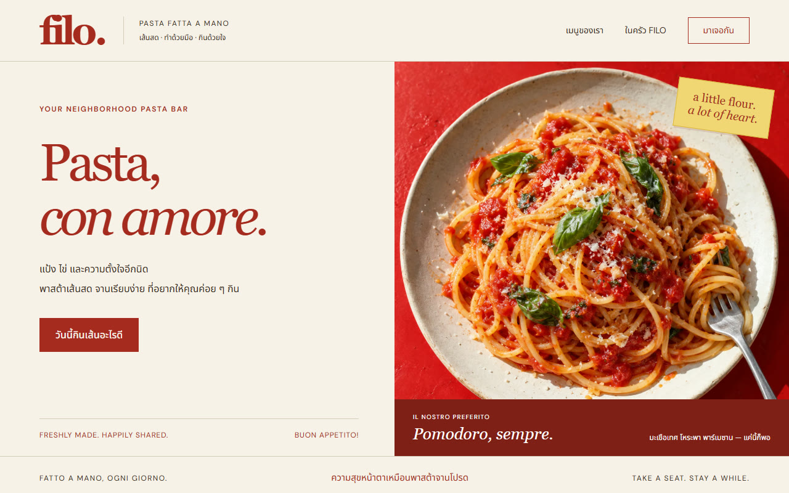
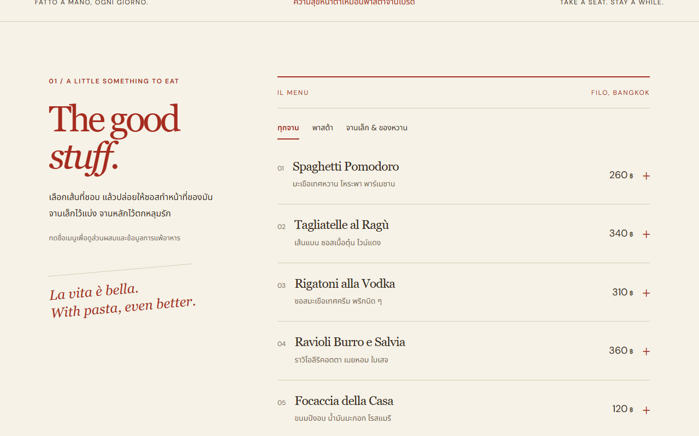
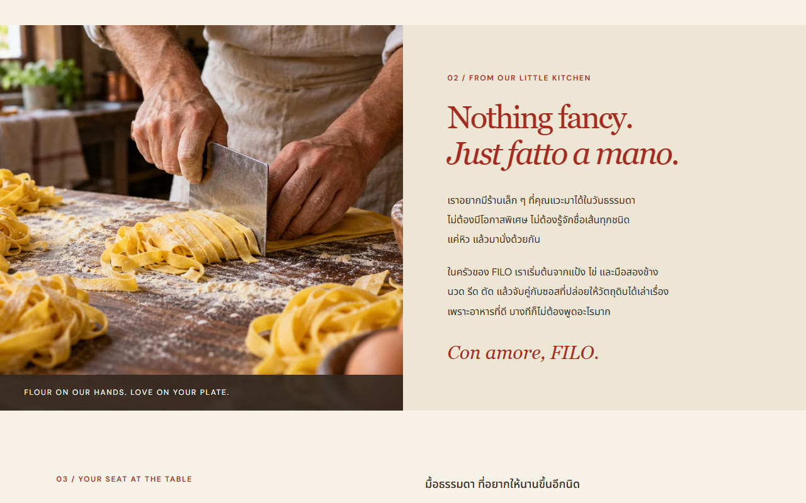
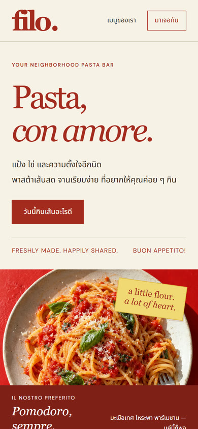

<div align="center">

# Intentional Craft

**An agent skill for distinctive, deliberate, evidence-checked design work: websites, interfaces, and games that don't look machine-assembled.**

[](LICENSE)


[English](#what-it-does) · [ภาษาไทย](#ภาษาไทย)


<sub><b>FILO</b>, a concept pasta-bar website built by an agent using this skill. All content, prices, and photos are fictional placeholders.</sub>

</div>

---

## What it does

Ask an agent for a "beautiful, original website" and you often get the same output: a centered hero, gradient blobs, glass cards, a bento grid, fake metrics. **Intentional Craft** gives the agent the working habits of an art director, product designer, developer, and a demanding first-time user, so that each visual choice is tied to the people using the product and the content it has to carry.

It treats perfectionism as **observation and revision**. It doesn't encourage endless polishing, and it doesn't let the agent claim the result is flawless.

| Phase | What the agent does |
| --- | --- |
| **1. Establish the experience** | Writes a compact brief: person and situation, outcome, emotional intent, scope, and observable acceptance conditions. |
| **2. Choose with intent** | Compares 2–3 genuinely different directions, then records a **direction card**: concept, composition, type, palette, imagery, motion, and one distinctive motif. |
| **3. Reject generic patterns** | Runs a **substitution test**: if swapping the name and accent color makes the design fit an unrelated product, the interchangeable parts get redesigned. |
| **4. Build the complete experience** | Builds end to end with real content and covers every state: loading, empty, error, recovery, keyboard, and small screens. |
| **5. Observe, critique, repair** | Uses the rendered artifact and logs each issue as *observation → user consequence → change → recheck*. |
| **6. Finish deliberately** | Checks evidence-based gates, stops when another revision has no identifiable benefit, and labels anything it couldn't verify. |

The skill also includes domain playbooks:

- [`references/websites.md`](references/websites.md) covers page composition around the real task, visual grammar, Thai typography checks, content honesty, and interaction states.
- [`references/games.md`](references/games.md) covers player fantasy, core loop, tension, design pillars, deriving art from mechanics, and real playtesting instead of reading code.

## Showcase: FILO

FILO is a fictional neighborhood pasta bar in Bangkok. An agent designed and built it with this skill as a static site with Thai and Italian copy, a filterable menu, accessible dish details, and responsive layouts.

| Hero | Menu |
| --- | --- |
|  |  |
| **Kitchen story** | **Mobile (390 px)** |
|  |  |

The agent compared three directions (a dark dinner room, a process-led kitchen journal, and a bright neighborhood pasta counter) and chose the counter. The result uses tomato-red ink on butter paper, oversized serif display type paired with readable Thai, thin rules, an informal paper-menu rhythm, and one rotated caption as its motif. There are no pill badges, gradients, repeating feature cards, or fake endorsements.

> [!NOTE]
> The showcase is a design prototype. The photos are generated placeholders, and there is no ordering, booking, or payment backend.

## Installation

The skill is a plain folder with a `SKILL.md` entry point. It doesn't depend on any particular model, framework, or paid service.

**Claude Code** (personal skills):

```bash
git clone https://github.com/ikarisz/intentional-craft.git ~/.claude/skills/intentional-craft
```

Or install it per project into `.claude/skills/intentional-craft/`.

**Codex / other agents that support `SKILL.md` folders:** copy the whole folder into the skills location your agent uses.

**Agents without skill support:** attach or paste `SKILL.md` together with whichever reference file fits the task (`websites.md` or `games.md`).

> Keep the folder structure intact. `SKILL.md` links to the reference files by relative path.

## Usage

The skill triggers automatically on design, build, or review work that calls for distinctive art direction. You can also invoke it explicitly:

```text
Use intentional-craft to design and build a booking site for a ceramics workshop.
Audience: Thai visitors on mobile. Primary goal: book a class.
I have 6 real photos. Use only the facts I provide — no invented reviews or customer counts.
Pick an art direction with reasons, then test the booking path and error recovery for real.
```

```text
Use intentional-craft to prototype a browser game about a lighthouse keeper who navigates by sound.
Keyboard and mobile. Two-day budget. Start from player fantasy, core loop, decisions and pillars,
then build one complete slice — learning, goal, failure consequence and restart — and actually play it.
```

For targeted fixes, the skill applies only the quality checks that are relevant inside the requested scope. It won't start a redesign you didn't ask for.

## Repository layout

```
intentional-craft/
├── SKILL.md              # Main instructions (English, portable across agents)
├── USAGE.th.md           # Thai usage guide
├── references/
│   ├── websites.md       # Website & interface craft
│   └── games.md          # Game design & development craft
└── docs/                 # README media (FILO showcase)
```

## Honest limits

- A skill is a set of portable instructions. Every agent loads it differently, so it can't guarantee flawless or universally original output.
- The skill tells the agent not to claim "perfect", "production-ready", "fully accessible", or "fun" unless it has evidence for that claim.
- Quality still has to be verified against the real artifact, tools, and audience for each project.

---

## ภาษาไทย

**Intentional Craft** คือสกิลสำหรับ AI agent ที่ทำให้ agent ออกแบบและสร้างเว็บไซต์ อินเทอร์เฟซ และเกมอย่างประณีต มีทิศทางศิลป์ที่มีเหตุผล คิดถึง UX และตรวจงานจากการใช้งานจริง แทนการหยิบหน้าตาสำเร็จรูปแบบ "AI slop"

- เข้าใจคนใช้ เป้าหมาย อารมณ์ และข้อจำกัด ก่อนเลือกหน้าตางาน
- เปรียบเทียบทิศทางศิลป์ 2–3 แบบ แล้วบันทึก direction card
- ใช้ **substitution test** ตรวจว่าถ้าเปลี่ยนแค่ชื่อกับสี งานจะกลายเป็นเว็บของใครก็ได้หรือไม่
- ออกแบบสถานะโหลด ว่าง ผิดพลาด และการกู้คืนให้ครบ
- ใช้งานหรือเล่นของจริง แยกหลักฐานที่ทดสอบแล้วออกจากความเห็น และหยุดเมื่อผ่านเกณฑ์

ดูวิธีติดตั้งและตัวอย่างคำสั่งภาษาไทยแบบเต็มได้ที่ [USAGE.th.md](USAGE.th.md)

## License

[MIT](LICENSE) © 2026 ikarisz
